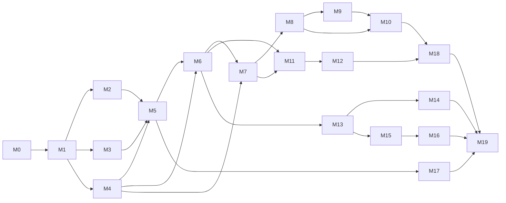

# Roadmap

This is the plan for building aviscape from an empty repository to a
field-tested 1.0 release. It is grounded in the [research notes](docs/research.md),
the [target architecture](docs/architecture.md) and the
[architecture decision records](docs/adr/).

- **Last updated:** 2 November 2026
- **Status:** planning done; implementation starts with [M0](#m0--foundations-and-engineering-standards).
- **Size:** 20 milestones, 163 work items, **728 estimated hours** (about
  875 hours with a 20 % contingency). At 15 hours a week that is roughly
  eleven months; at 25 hours a week, about seven.

**How to read it.** Estimates are focused working hours and include tests and
documentation for the item. Item IDs (for example `M5.6`) are stable: each
item becomes a GitHub issue with the same ID in its title and a label for its
milestone, and the item is ticked off here when its issue closes. Milestones
are ordered by dependency, and each ends with a demo that proves it works.

## Contents

1. [Vision](#1-vision)
2. [Goals and non-goals](#2-goals-and-non-goals)
3. [Principles](#3-principles)
4. [Architecture at a glance](#4-architecture-at-a-glance)
5. [Service level objectives](#5-service-level-objectives)
6. [Technology choices](#6-technology-choices)
7. [Definition of done](#7-definition-of-done)
8. [Milestones overview](#8-milestones-overview)
9. [Milestones in detail](#9-milestones-in-detail)
10. [Risks and mitigations](#10-risks-and-mitigations)
11. [Open questions](#11-open-questions)
12. [Progress log](#12-progress-log)

---

## 1. Vision

> A live, trustworthy picture of how active the bird soundscape is at any
> open microphone in the world, minute by minute, built only from
> explainable signal processing and run with the discipline of a production
> data platform.

aviscape listens to live open microphones (and, optionally, your own),
turns each minute of sound into published acoustic indices at the edge,
streams those features through Kafka into a DuckLake lakehouse, joins them
with weather, sun position and species context, checks their quality, and
serves them to a live dashboard: growing false-colour spectrograms, dawn
chorus timing and weather-aware activity trends.

## 2. Goals and non-goals

### Goals

| ID | Goal | Measured by |
| :-- | :-- | :-- |
| G1 | Real time: a closed one-minute window is visible in the live view within seconds | p95 latency SLO (section 5) |
| G2 | Trustworthy numbers: every value carries its quality flags and provenance | DQ coverage: 100 % of silver rows have QA flags |
| G3 | Reproducible: the same audio and configuration give identical results | golden tests; pinned lake snapshots for reports |
| G4 | Small: runs on a laptop inside a 2 GiB storage budget | budget asset check |
| G5 | Private by construction: no audio and no personal data at rest | audit tests (M5.8); data inventory (M10.7) |
| G6 | Production-grade engineering: contracts, CI/CD, observability, GitOps, signed artefacts | the definition of done (section 7) applied to every item |

### Non-goals

- **Species identification.** No classifiers, trained models or inference of
  any kind ([ADR 0002](docs/adr/0002-deterministic-signal-processing-without-machine-learning.md)).
  Species reported by BirdWeather's community stations are shown only as
  labelled, aggregated third-party context, never evaluated or used as
  ground truth ([ADR 0008](docs/adr/0008-birdweather-detections-as-third-party-context.md)).
- **Storing or replaying live audio** ([ADR 0003](docs/adr/0003-raw-audio-never-leaves-memory.md)).
- **User accounts or user-contributed data.** The dashboard and API are
  read-only and anonymous.
- **Biodiversity scores.** Indices are presented as soundscape activity
  measures, with their documented limits.
- **Redistributing third-party data.** The public demo uses synthetic data
  only.

## 3. Principles

1. **Walking skeleton first.** A thin end-to-end slice (M1) runs before any
   layer is deepened, so integration problems surface in week two, not month
   six.
2. **Contracts at every boundary.** Every topic and table has a versioned
   schema and an ODCS contract; incompatible changes fail CI.
3. **Event time, not processing time.** Windows, lateness and deduplication
   are defined on event time, with uncertainty made explicit.
4. **Exactly once where it matters, idempotent everywhere.** Each hop's
   guarantee is written down and tested under failure.
5. **Budgets are code.** Storage, bandwidth, latency, image size and DSP
   speed have numeric budgets checked automatically.
6. **Everything as code.** Infrastructure, dashboards, alerts, topics,
   contracts and documentation live in this repository.
7. **Local-first, cloud-ready.** `docker compose` on a laptop is the primary
   environment; the same images run on Kubernetes through Helm and Argo CD.
8. **Explain, don't predict.** Every number is a documented function of its
   inputs, with a citation where one exists.

## 4. Architecture at a glance

```text
 open microphones ─┐
 own microphone ───┤   edge agent (in-memory audio)         Kafka 4.x (KRaft)
 synthetic replay ─┼─► decode ► 60 s windows ► indices ───► + Karapace (Avro)
 xeno-canto corpus ┘            QA flags, events, bands          │
                                                                 ▼
 Open-Meteo, GBIF,      Dagster assets ──► dbt models     Quix Streams: validate,
 BirdWeather, catalog ► + asset checks       │            dedup, enrich, rollups
                                             ▼                   │
                        DuckLake (SeaweedFS S3 + PostgreSQL) ◄───┘ exactly-once sink
                                             │
                        FastAPI (REST + live SSE) ──► web dashboard
                                             │
                        OpenTelemetry ──► Grafana (metrics, logs, traces)
```

Details: [docs/architecture.md](docs/architecture.md).

## 5. Service level objectives

Targets for the default configuration (5 live streams, laptop deployment).
They become alerting rules in M14.4.

| SLI | Objective | Window |
| :-- | :-- | :-- |
| End of window → live API (p95) | ≤ 15 s | 28 days |
| End of window → silver table (p95) | ≤ 5 min | 28 days |
| End of window → gold marts | ≤ 60 min | 28 days |
| Windows produced at the edge that reach bronze | ≥ 99.5 % | per sensor-day |
| Duplicate `(sensor_id, window_start)` rows in silver | 0 | always |
| Silver rows with complete QA flags | 100 % | always |
| API availability (local and demo) | ≥ 99 % | 28 days |
| API latency, one sensor-day query (p95) | ≤ 200 ms | 28 days |
| Storage at rest | ≤ 2 GiB (warn at 80 %) | continuous |
| DSP throughput | ≥ 100× real time per x86 core; ≥ 10× on a Raspberry Pi 4 | per release |

Upstream stream availability is measured separately and does not count
against the platform's objectives.

## 6. Technology choices

Chosen after the review in [research notes, section 7](docs/research.md#7-tool-landscape-checked-2-november-2026).
Every runtime dependency must have a licence compatible with MIT; services
run as unmodified containers.

| Concern | Choice | Why | Alternatives considered |
| :-- | :-- | :-- | :-- |
| Language and packaging | Python 3.13 baseline (3.14 also tested), uv workspace | dbt-core 1.11 supports up to 3.13; uv gives fast, locked, reproducible environments | Poetry, PDM |
| Lint, format, types | Ruff, mypy `--strict` | fast, strict, standard | ty (beta until 1.0), Pyright |
| Signal processing | NumPy, SciPy; PyAV for decoding | deterministic, permissive licences | librosa (heavier); scikit-maad used only offline to produce golden test values |
| Streaming | Apache Kafka 4.x (KRaft) | no ZooKeeper; transactions; compacted topics ([ADR 0004](docs/adr/0004-kafka-avro-and-karapace-for-streaming.md)) | Redpanda (BSL), NATS JetStream, MQTT |
| Schemas | Avro + Karapace | Apache-2.0, Confluent-compatible API | Confluent Schema Registry (community licence), Apicurio |
| Stream processing | Quix Streams | Python, stateful, exactly-once | Flink / PyFlink, Bytewax, Faust fork |
| Object storage | SeaweedFS (S3 API) | Apache-2.0, maintained ([ADR 0005](docs/adr/0005-ducklake-on-s3-compatible-storage.md)) | MinIO CE (maintenance mode), Garage (AGPL), RustFS |
| Table format | DuckLake 1.0, PostgreSQL catalog | SQL transactions for exactly-once; data inlining for small writes | Apache Iceberg, Delta Lake |
| Query engine | DuckDB | embedded, fast, one engine for sink, dbt and API | ClickHouse, Trino |
| Orchestration | Dagster 1.13 | assets, partitions, checks, freshness ([ADR 0006](docs/adr/0006-dagster-and-dbt-for-batch.md)) | Airflow 3, Prefect 3, Kestra |
| Transformations | dbt-core 1.x + dbt-duckdb | contracts, tests, unit tests, docs | SQLMesh; dbt Core v2 (alpha) |
| Data contracts | ODCS v3.1 + `datacontract-cli` | open standard, CI-friendly | ad-hoc JSON Schema |
| Data quality | dbt tests, Dagster asset checks, domain QA rules | one results table; no overlapping frameworks | Soda Core v4, GX Core |
| API | FastAPI, Pydantic v2 | typed, OpenAPI 3.1, SSE | Litestar |
| Dashboard | TypeScript, Vite, MapLibre GL, Canvas | fast, small, no framework lock-in for the heavy rendering | Grafana only, Streamlit |
| Observability | OpenTelemetry → Grafana LGTM (Prometheus/Mimir, Loki, Tempo) | vendor-neutral, traces across Kafka | Jaeger + ELK |
| Containers | Docker, Compose profiles, buildx multi-arch | laptop and Raspberry Pi from one build | Podman |
| Kubernetes | kind, Helm 4, Strimzi, CloudNativePG, Argo CD, KEDA, Envoy Gateway (Gateway API) | ingress-nginx is retired; operators for stateful parts | k3d, Flux |
| Supply chain | syft (SBOM), cosign, GitHub artifact attestations, Renovate | signed, attested, current | |
| Docs | Zensical, Mermaid | successor to Material for MkDocs | Docusaurus |
| CI/CD | GitHub Actions, release-please, Conventional Commits | native to the repository | |

## 7. Definition of done

An item is done when all of the following hold:

- [ ] Code is formatted, linted (Ruff) and type-checked (mypy `--strict`).
- [ ] Tests cover the behaviour: unit tests always; integration tests for
      anything that crosses a process boundary; coverage gates met (90 % for
      `aviscape-dsp`, 80 % elsewhere).
- [ ] Contracts and schemas are updated and compatible, or a new major
      version is introduced on purpose.
- [ ] New runtime behaviour emits logs, metrics and traces.
- [ ] New data has quality checks and an entry in the data inventory.
- [ ] Docs are updated (README, docs page, ADR if a significant decision was
      made, this roadmap's checkbox).
- [ ] No secrets, no audio files, no personal data; `.env.example` lists any
      new variable.
- [ ] CI is green; the change is a reviewed pull request with a Conventional
      Commit title.

## 8. Milestones overview

| Phase | Milestone | Theme | Hours | Release |
| :-- | :-- | :-- | --: | :-- |
| A. Foundations | [M0](#m0--foundations-and-engineering-standards) | Foundations and engineering standards | 28 | |
| | [M1](#m1--walking-skeleton) | Walking skeleton | 22 | v0.1.0 |
| B. Core science and contracts | [M2](#m2--signal-processing-core) | Signal-processing core | 67 | |
| | [M3](#m3--synthetic-soundscapes-and-replay) | Synthetic soundscapes and replay | 34 | |
| | [M4](#m4--contracts-and-schemas) | Contracts and schemas | 27 | v0.2.0 |
| C. Real-time path | [M5](#m5--edge-agent) | Edge agent | 53 | |
| | [M6](#m6--streaming-backbone-and-stream-processing) | Streaming backbone and stream processing | 55 | v0.3.0 |
| D. Lakehouse and batch | [M7](#m7--lakehouse) | Lakehouse | 41 | |
| | [M8](#m8--batch-ingestion-and-orchestration) | Batch ingestion and orchestration | 55 | |
| | [M9](#m9--transformations-and-data-modelling) | Transformations and data modelling | 45 | v0.4.0 |
| E. Quality, serving, UI | [M10](#m10--data-quality-and-governance) | Data quality and governance | 36 | |
| | [M11](#m11--serving-api) | Serving API | 28 | |
| | [M12](#m12--web-dashboard) | Web dashboard | 51 | v0.5.0 |
| F. Platform operations | [M13](#m13--containers-and-local-platform) | Containers and local platform | 24 | |
| | [M14](#m14--observability-and-reliability) | Observability and reliability | 33 | v0.6.0 |
| G. Kubernetes and supply chain | [M15](#m15--kubernetes-and-gitops) | Kubernetes and GitOps | 45 | |
| | [M16](#m16--supply-chain-security-and-repository-hygiene) | Supply-chain security and repository hygiene | 14 | v0.7.0 |
| H. Field, insight, release | [M17](#m17--edge-reference-node) | Edge reference node (optional hardware) | 20 | |
| | [M18](#m18--analysis-and-ecological-insight) | Analysis and ecological insight | 29 | |
| | [M19](#m19--documentation-and-v10-release) | Documentation and v1.0 release | 21 | v1.0.0 |
| | | **Total** | **728** | |

### Dependencies



### Releases

| Version | After | What a user can do |
| :-- | :-- | :-- |
| v0.1.0 | M1 | run the walking skeleton on a laptop with synthetic audio |
| v0.2.0 | M4 | compute every index on any audio file; read the published contracts |
| v0.3.0 | M6 | monitor live open microphones in real time |
| v0.4.0 | M9 | query a lakehouse with weather, sun and species context |
| v0.5.0 | M12 | open the live dashboard; browse the public static demo |
| v0.6.0 | M14 | start the full stack with one command, with dashboards and alerts |
| v0.7.0 | M16 | deploy to Kubernetes through GitOps with signed, attested images |
| v1.0.0 | M19 | use a field-tested, fully documented platform |

---

## 9. Milestones in detail

### M0 — Foundations and engineering standards

**Goal:** a repository in which every later change is formatted, typed,
tested, scanned for secrets and released the same way. **Estimate: 28 h.**

| ID | Work item | Est. (h) | Done when |
| :-- | :-- | --: | :-- |
| ✅ M0.1 | uv workspace with Python 3.13; package skeletons (`aviscape-dsp`, `aviscape-synth`, `aviscape-contracts`, `aviscape-edge`, `aviscape-stream`, `aviscape-api`) in `src/` layout with PEP 621 metadata; lockfile committed | 3 | `uv sync --locked` works on a fresh clone and every package imports |
| ✅ M0.2 | Ruff (lint and format) and mypy `--strict`; `py.typed` markers | 2 | `just lint` passes; a deliberate violation fails CI |
| ✅ M0.3 | pytest with branch coverage, pytest-xdist, Hypothesis profiles (`dev`, `ci`); coverage gates | 3 | `just test` reports coverage; gates enforced in CI |
| M0.4 | Extend pre-commit: Ruff, mypy, yamllint, actionlint, hadolint, shellcheck, markdownlint-cli2, Conventional Commit message check | 2 | all hooks pass on the repository |
| M0.5 | `justfile` with documented recipes (`setup`, `lint`, `test`, `up`, `down`, `demo`, `docs`) | 1 | `just --list` documents every recipe |
| M0.6 | GitHub Actions CI: lint, types, tests on 3.13 and 3.14; uv cache; concurrency groups; least-privilege `permissions`; actions pinned by SHA | 3 | CI green on `main`; median run under 5 minutes |
| M0.7 | Governance: CONTRIBUTING, CODE_OF_CONDUCT (Contributor Covenant 2.1), SECURITY.md, issue forms, PR template, CODEOWNERS, labels, ruleset protecting `main` | 3 | a test PR shows the template and required checks |
| M0.8 | Renovate with grouped updates, lockfile maintenance and a weekly schedule | 2 | first Renovate PRs open and pass CI |
| M0.9 | Release automation with release-please: Conventional Commits, CHANGELOG, SemVer tags, GitHub Releases | 2 | merging a `feat:` PR opens a release PR |
| M0.10 | Dev container (VS Code and Codespaces) with uv, just and Docker-in-Docker | 2 | `just test` passes inside the container |
| M0.11 | Docs site with Zensical, Mermaid and the existing research and ADRs; deployed to GitHub Pages from CI | 3 | site is live and rebuilt on every merge |
| M0.12 | Licence compliance check: allow-list of dependency licences; fail on copyleft or unknown licences in shipped Python packages | 2 | an added GPL dependency fails CI |

**Demo:** open a pull request, watch every check run, merge it, and see a
release PR and an updated docs site.

### M1 — Walking skeleton

**Goal:** the thinnest possible end-to-end slice, from synthetic audio to an
HTTP response, wired the way the final system will be. **Estimate: 22 h.**

| ID | Work item | Est. (h) | Done when |
| :-- | :-- | --: | :-- |
| M1.1 | Minimal synthetic source: seeded tone-plus-noise generator emitting 60 s frames, real time or accelerated | 2 | same seed gives byte-identical audio |
| M1.2 | Minimal DSP: STFT, RMS dBFS and NDSI, with analytic tests | 3 | NDSI of band-limited synthetic noise matches the expected value |
| M1.3 | Single-node Kafka 4.x (KRaft) in Compose; one topic; JSON payload for now | 2 | `just up` starts a healthy broker |
| M1.4 | Producer, and a consumer that upserts into a local DuckDB file keyed by `(sensor_id, window_start)` | 4 | replaying the same hour twice leaves 60 rows |
| M1.5 | FastAPI endpoint `GET /v1/sensors/{id}/minutes` reading DuckDB | 3 | OpenAPI page lists the endpoint; contract test passes |
| M1.6 | `just demo`: replays one synthetic hour in under a minute | 3 | command finishes and prints a summary |
| M1.7 | End-to-end test in CI: Compose up → replay → API returns 60 rows with expected NDSI (±1e-6) | 4 | test is required on `main` |
| M1.8 | Architecture doc: table of "skeleton now vs. target later" | 1 | doc merged |

**Demo:** `just up && just demo && curl localhost:8000/v1/sensors/synthetic-1/minutes`.

### M2 — Signal-processing core

**Goal:** `aviscape-dsp`, a pure, fast, deterministic library of published
soundscape measures, each tested against analytic expectations and an
independent implementation. **Estimate: 67 h.**

| ID | Work item | Est. (h) | Done when |
| :-- | :-- | --: | :-- |
| M2.1 | Audio frame model: mono down-mix, polyphase resampling to 22.05 kHz, integer and float handling, DC removal | 4 | resampled sine keeps frequency and level within tolerance |
| M2.2 | Spectrogram engine: STFT (Hann, 512-sample frames by default), documented amplitude, power and dB conventions, float32 throughout | 4 | Parseval check and known-tone tests pass |
| M2.3 | Signal QA metrics: clipping ratio, DC offset, RMS and peak dBFS, crest factor, digital-silence runs, dropouts | 4 | each metric has a synthetic fault that triggers it |
| M2.4 | Background noise (mode-based BGN per bin) and SNR, after Towsey (2017) | 4 | BGN of stationary noise within 0.5 dB of its true level |
| M2.5 | Entropy: temporal (Ht), spectral (Hf) and H (Sueur et al., 2008) | 3 | white noise gives Ht and Hf near 1; a pure tone gives low Hf |
| M2.6 | Acoustic Complexity Index (Pieretti et al., 2011), summary and per-bin | 4 | a stationary tone gives near-zero ACI; modulated tones rank higher |
| M2.7 | ADI and AEI (Villanueva-Rivera et al., 2011) with threshold and band-step parameters | 3 | uniform band occupancy maximises ADI and minimises AEI |
| M2.8 | Bioacoustic Index (Boelman et al., 2007), 2–8 kHz default | 2 | energy added inside the band raises BI; outside it does not |
| M2.9 | NDSI (Kasten et al., 2012), anthrophony 1–2 kHz, biophony 2–11 kHz, finalised | 2 | values bounded in [−1, 1]; symmetric test cases pass |
| M2.10 | Event rate (EVN) and acoustic activity (ACT) after Towsey (2017) | 3 | synthetic clicks at a known rate are counted correctly |
| M2.11 | Spectral index vectors (ACI, ENT, EVN, BGN, PMN per bin) and false-colour composition (index bounds, RGB mapping) | 6 | a 24 h synthetic day renders a recognisable dawn chorus band |
| M2.12 | Band-limited event detector: hysteresis thresholds over BGN, minimum duration and gap, frequency bounds | 6 | synthetic chirps are found with exact counts and bounds within one bin |
| M2.13 | Parameter registry: every measure declares parameters, units, valid range and citation; emitted as output metadata | 3 | docs table generated from the registry |
| M2.14 | Correctness suite: analytic cases; Hypothesis properties (bounds, determinism, gain behaviour); golden values from scikit-maad generated once in an isolated environment and committed | 8 | all measures agree with golden values within documented tolerances |
| M2.15 | Performance: vectorised NumPy; pytest-benchmark suite with a regression threshold in CI | 4 | ≥ 100× real time per x86 core |
| M2.16 | Mutation testing with mutmut on the index module; surviving mutants triaged | 3 | mutation score recorded; survivors fixed or justified |
| M2.17 | Index reference pages: formula, parameters, interpretation, caveats (Alcocer et al., 2022) | 4 | one page per measure in the docs site |

**Demo:** `aviscape-dsp analyse some.wav --report` prints every index with
its parameters and citations, and writes a false-colour strip.

### M3 — Synthetic soundscapes and replay

**Goal:** `aviscape-synth`, realistic, seeded, privacy-free test audio and a
fleet simulator with fault injection, so everything downstream can be tested
without live streams. **Estimate: 34 h.**

| ID | Work item | Est. (h) | Done when |
| :-- | :-- | --: | :-- |
| M3.1 | Bird-like vocalisations: FM sweeps, trills, harmonic stacks and pulse trains with parameter ranges | 6 | spectrogram gallery in the docs; seeded and deterministic |
| M3.2 | Diel and seasonal activity model relative to civil dawn (dawn chorus density, dusk, night) using `astral` | 4 | activity curve shifts with date and latitude as expected |
| M3.3 | Geophony and anthrophony: rain (impulses plus broadband), wind (low-frequency gusts), traffic hum, aircraft passes | 4 | each source moves the indices in the documented direction |
| M3.4 | Fault injection: clipping, dropouts, DC offset, digital silence, wrong sample rate | 3 | each fault is caught by the matching QA metric from M2.3 |
| M3.5 | Replay simulator: N virtual sensors, real time or accelerated; chaos options (jitter, clock skew, duplicates, reordering, gaps, producer crash) | 8 | 100 sensors at 60× run on a laptop; chaos is reproducible by seed |
| M3.6 | Optional xeno-canto replay corpus: API v3 client (key from env), excludes NoDerivatives licences, 150 MB cap, cache outside git, manifest of catalogue numbers and licences only | 6 | corpus builds from a clean cache; no recordist names stored |
| M3.7 | Golden scenarios ("rainy dawn", "quiet night", "clipping sensor", "flaky stream") used by end-to-end tests | 3 | scenarios have expected outputs checked into `tests/fixtures/` |

**Demo:** `just simulate --sensors 20 --speed 60 --scenario rainy-dawn`.

### M4 — Contracts and schemas

**Goal:** every topic and table has a versioned schema and an ODCS
contract, and incompatible changes cannot reach `main`. **Estimate: 27 h.**

| ID | Work item | Est. (h) | Done when |
| :-- | :-- | --: | :-- |
| M4.1 | Avro schemas for all topics in [the topic catalogue](docs/architecture.md#3-topics); naming and versioning convention | 5 | schemas compile; docs list fields and units |
| M4.2 | Karapace in Compose; `TopicNameStrategy`; `BACKWARD_TRANSITIVE` compatibility; registration at bootstrap | 4 | an incompatible schema is rejected by the registry |
| M4.3 | ODCS v3.1 contracts for topics and lake tables: schema, quality rules, freshness and completeness SLAs, owner, terms | 6 | `datacontract lint` passes for every contract |
| M4.4 | Generated typed Python models from the schemas (one source of truth); drift check in CI | 5 | editing a schema without regenerating fails CI |
| M4.5 | CI gates: contract lint, breaking-change diff against `main`, registry compatibility test | 4 | a breaking change in a PR fails with a readable message |
| M4.6 | Data catalogue pages generated from the contracts into the docs site | 3 | catalogue is browsable on the docs site |

**Demo:** a PR that renames a field fails with the exact consumers it would
break.

### M5 — Edge agent

**Goal:** `aviscape-edge`, which listens to many streams robustly, turns each
minute into features in memory and delivers them without loss.
**Estimate: 53 h.**

| ID | Work item | Est. (h) | Done when |
| :-- | :-- | --: | :-- |
| M5.1 | Source adapters: Icecast/HTTP (PyAV), HLS, local microphone (`sounddevice`/PortAudio), file and replay | 10 | each adapter passes the same conformance test suite |
| M5.2 | Resilience: reconnect with exponential backoff and jitter, stall detection, per-stream circuit breaker, graceful shutdown that finishes the current window | 6 | killing and restoring a test Icecast server loses no complete window |
| M5.3 | Windowing: UTC-aligned 60 s windows, event time from sample position and arrival time, drift detection, `time_uncertainty_s`, partial-window policy | 6 | windows align to minute boundaries across reconnects |
| M5.4 | Duty-cycle scheduler: continuous, periodic, and dawn-weighted schedules from sun position; schedules as config | 5 | schedule for a given date and place matches a reference table |
| M5.5 | Kafka producer: idempotence, `acks=all`, zstd compression, Avro serialiser with the registry, keyed by `sensor_id` | 4 | integration test shows no duplicates after producer retries |
| M5.6 | Store-and-forward spool: bounded on-disk queue of features (never audio) for broker outages; drained in order on reconnect | 5 | a 30-minute broker outage loses nothing within the spool budget |
| M5.7 | Live band levels: one-second third-octave levels to a 24-hour topic, never persisted to the lake | 4 | live view data present in Kafka; absent from the lake |
| M5.8 | Privacy guarantees: audio only in memory, enforced by a filesystem-write audit in tests and a scan of logs and traces; catalogue name stripping and coordinate coarsening | 4 | audit test fails if any audio byte is written anywhere |
| M5.9 | Telemetry: OpenTelemetry metrics (decode lag, windows emitted, reconnects), structured JSON logs, heartbeat topic | 3 | metrics visible in the local collector |
| M5.10 | Multi-arch container image (amd64, arm64) | 2 | image runs on x86 and on an ARM64 emulator |
| M5.11 | Integration tests with testcontainers; 24-hour soak test at real time against the simulator | 4 | soak report shows stable memory and no missed windows |

**Demo:** the agent listens to three live open microphones and a simulated
sensor at once; pulling the network cable loses nothing.

### M6 — Streaming backbone and stream processing

**Goal:** validated, deduplicated, enriched streams with defined guarantees,
plus live state for every sensor. **Estimate: 55 h.**

| ID | Work item | Est. (h) | Done when |
| :-- | :-- | --: | :-- |
| M6.1 | Kafka topology as code: `topics.yaml` (partitions, retention time and bytes, cleanup policy, `min.insync.replicas`) with an idempotent apply tool; byte caps derived from the budget | 5 | applying twice is a no-op; drift is reported |
| M6.2 | Stream processor (Quix Streams): deserialise, validate against contracts, reason-coded dead-letter topic | 6 | every rejection reason has a test and a metric |
| M6.3 | Deduplication with a state store keyed by `(sensor_id, window_start)` and a TTL | 4 | chaos replay with duplicates yields zero duplicates downstream |
| M6.4 | Event-time handling: watermarks, grace period, late-record routing and metrics | 5 | reordered and late records are handled exactly as documented |
| M6.5 | Enrichment: join with the compacted sensor registry; sun phase and minutes from civil dawn; coarse grid cell | 5 | enriched records carry sun-relative time for any latitude |
| M6.6 | Rolling aggregates: 15-minute and hourly windows per sensor | 4 | aggregates equal a batch recomputation |
| M6.7 | Sensor status state machine (online, degraded, offline, quarantined) from heartbeats and QA; alerts topic | 5 | status transitions follow the documented state diagram |
| M6.8 | Dawn chorus onset detector: first sustained exceedance of the sensor's bird-band baseline after nautical dawn; emitted as an event | 5 | onset found within ±2 minutes on synthetic scenarios |
| M6.9 | Processing guarantees: exactly-once via Kafka transactions; semantics per hop documented; failure-injection tests (kill mid-transaction) | 6 | no loss and no duplication across 50 injected crashes |
| M6.10 | Load test: 100 virtual sensors at 60×; capacity notes (partitions, instances) | 4 | report with throughput and lag curves |
| M6.11 | Live BirdWeather context: `newDetection` subscription filtered to stations near each sensor (station IDs in memory only, private stations excluded), aggregated to 15-minute species counts per grid cell on `aviscape.context.birdweather-counts.v1`; polling fallback; kill switch; enabled only after M8.11 | 6 | counts match a recorded synthetic event stream; no station identifiers in any topic |

**Demo:** chaos replay with duplicates, reordering and a crashed processor,
and a clean, gap-free enriched stream at the end.

### M7 — Lakehouse

**Goal:** a DuckLake lakehouse on S3-compatible storage with exactly-once
ingestion, maintenance, tiered storage and measured budgets.
**Estimate: 41 h.**

| ID | Work item | Est. (h) | Done when |
| :-- | :-- | --: | :-- |
| M7.1 | SeaweedFS (S3), PostgreSQL catalog and DuckLake 1.0 in Compose; bucket layout; credentials from env | 5 | DuckDB attaches the lake from a fresh `just up` |
| M7.2 | Bronze sink: Kafka to DuckLake in micro-batches using data inlining; Kafka offsets stored in the same catalog transaction | 12 | crash-at-any-point tests show exactly-once rows |
| M7.3 | Partitioning and sort order (sensor, date); target file sizes | 3 | query plans prune partitions for one-sensor-day queries |
| M7.4 | Table maintenance: flush inlined data, merge adjacent files, expire snapshots, remove orphaned files | 5 | file count stays bounded over a 7-day simulation |
| M7.5 | Tiered spectral storage: float32 for 7 days, then uint8 with 128 bins (error bounds documented), hourly archive | 6 | quantisation error within the documented bound; sizes match the budget |
| M7.6 | Snapshot pinning for reproducible reports (time travel) | 2 | a report rebuilt from a pinned snapshot is byte-identical |
| M7.7 | Budget accounting: bytes per table, bucket, catalog and topic as metrics and a table; measured compression ratios | 4 | measured sizes replace the estimates in the research notes |
| M7.8 | Backup and restore: catalog dump plus object sync; runbook; RPO and RTO stated; restore drill | 4 | a drill restores the lake on a clean machine |

**Demo:** kill the sink at random points for an hour of replay; row counts
equal Kafka offsets exactly.

### M8 — Batch ingestion and orchestration

**Goal:** Dagster owns every scheduled and event-driven batch task, declared
as assets with checks. **Estimate: 55 h.**

| ID | Work item | Est. (h) | Done when |
| :-- | :-- | --: | :-- |
| M8.1 | Dagster project (Components, `dg` CLI); resources for DuckLake, HTTP (retries, rate limits, caching) and Kafka admin; local and container environments | 6 | `dg dev` shows the asset graph |
| M8.2 | Stream catalogue asset: Locus Sonus active list every 15 minutes; name stripping; coordinate coarsening; allow-list; SCD2 history; publishes to the sensor registry topic | 7 | a stream disappearing upstream closes its SCD2 row |
| M8.3 | Weather assets (Open-Meteo): hourly partitions per grid cell (precipitation, wind, temperature, cloud cover); archive backfills; under 1,000 calls a day; attribution metadata | 8 | a 30-day backfill completes within the call budget |
| M8.4 | Sun and moon ephemeris asset per sensor and day (`astral`) | 2 | values match a published almanac for test locations |
| M8.5 | GBIF context asset: monthly counts of bird species per grid cell from occurrence facets (no record-level data) | 6 | asset stores counts only; citation date recorded |
| M8.6 | Maintenance schedules: DuckLake maintenance, budget enforcement (trimming in documented priority order), topic audits | 4 | exceeding the budget in a test triggers trimming |
| M8.7 | Asset checks: freshness policies, volume and completeness, contract validation, budget | 6 | each check fails on a crafted bad input |
| M8.8 | Declarative automation conditions; retry policies; concurrency pools for external APIs | 3 | parallel backfills never exceed API limits |
| M8.9 | Tests: assets materialised in memory with recorded, synthetic HTTP fixtures; schedule and sensor tests | 4 | tests run offline in CI |
| M8.10 | Alerts on run or check failure through a configurable webhook | 2 | a failing check posts a test notification |
| M8.11 | Ask BirdWeather (support@birdweather.com) to confirm that non-commercial, aggregate-only use of the public GraphQL API is acceptable; record the answer in the licence register | 1 | written answer stored with the register; the connector stays off without it |
| M8.12 | BirdWeather context asset: hourly `counts` and `topSpecies` over each sensor's bounding box with a minimum-score filter; aggregates only; station names, IDs and private stations excluded; at most 4 calls per grid cell per hour; labelled as third-party automated detections | 6 | a 7-day backfill stays within the call limit; the schema has no station or detection-level fields |

**Demo:** Dagster UI showing the full asset graph from external APIs to
marts, with green checks and a freshness timeline.

### M9 — Transformations and data modelling

**Goal:** a tested dimensional model on DuckLake, from bronze to marts that
answer the project's questions. **Estimate: 45 h.**

| ID | Work item | Est. (h) | Done when |
| :-- | :-- | --: | :-- |
| M9.1 | dbt project on dbt-duckdb attached to DuckLake; profiles from env; SQLFluff style rules | 4 | `dbt build` runs in CI against fixture data |
| M9.2 | Staging models per source: renaming, typing, units; source freshness | 4 | one staging model per source with tests |
| M9.3 | Dimensions: `dim_sensor` (SCD2), `dim_date`, `dim_sun_time` (minutes from civil dawn and dusk) | 5 | daylight-saving and polar-day edge cases tested |
| M9.4 | Facts: `fct_minute_indices`, `fct_acoustic_events`, `fct_weather_hourly`, `fct_sensor_status` | 6 | grain documented and enforced by unique tests |
| M9.5 | Marts: `mart_daily_soundscape`, `mart_dawn_chorus`, `mart_weather_adjusted_activity`, `mart_ldfc_index` | 8 | each mart answers a question stated in its docs |
| M9.6 | Statistical baselines: rolling 14-day median and MAD per sensor and sun-relative minute; robust z-scores; rule-based "unusual activity" flags | 6 | flags reproduce hand-computed values on fixtures |
| M9.7 | Model contracts, generic and singular tests, dbt unit tests for tricky logic | 5 | every model has a contract and at least one test |
| M9.8 | dbt models as Dagster assets; dbt docs and exposures in the docs site | 3 | one lineage graph from source to API |
| M9.9 | `fct_birdweather_hourly` and `mart_species_context`: soundscape activity side by side with nearby automated detections and GBIF records; no accuracy or agreement metrics | 4 | mart documents its labelling rules; tests forbid detection-level columns |

**Demo:** "How did dawn chorus onset move over the last 30 days, and on
which mornings did rain make the numbers unreliable?" answered by one query.

### M10 — Data quality and governance

**Goal:** quality is measured, explained and acted on, and the data estate
is documented. **Estimate: 36 h.**

| ID | Work item | Est. (h) | Done when |
| :-- | :-- | --: | :-- |
| M10.1 | DQ framework: severity (info, warn, error, critical), action (flag, quarantine, reject), `dq_results` table, owners | 4 | every check writes to `dq_results` |
| M10.2 | Acoustic QA: rain flag from two-band power and SNR thresholds after hardRain, cross-checked with Open-Meteo precipitation; wind flag from low-band energy and wind speed; flags propagate to marts | 10 | agreement with weather data reported per sensor |
| M10.3 | Sensor health rules: flatlines, clipping storms, sustained digital silence, clock drift | 4 | each rule fires on its synthetic scenario |
| M10.4 | Completeness SLIs: expected vs. received minutes per sensor-day, accounting for the duty cycle | 3 | SLI shown per sensor in Grafana |
| M10.5 | Reconciliation: Kafka end offsets vs. bronze vs. silver counts, every hour | 4 | an injected loss is detected within an hour |
| M10.6 | Lineage: OpenLineage events from Dagster and dbt to Marquez (optional Compose profile) | 4 | lineage graph visible in Marquez |
| M10.7 | Governance docs: data inventory, retention schedule, licence and attribution register with quarterly review, privacy notes | 4 | inventory lists every table, its owner and retention |
| M10.8 | DQ dashboard and a weekly DQ report asset | 3 | report generated in CI from fixture data |

**Demo:** a rainy morning in the simulator is flagged, explained and
excluded from the weather-adjusted mart.

### M11 — Serving API

**Goal:** a fast, typed, read-only API for history and live data.
**Estimate: 28 h.**

| ID | Work item | Est. (h) | Done when |
| :-- | :-- | --: | :-- |
| M11.1 | FastAPI app: sensors, minute indices, daily summaries, events, dawn chorus, QA flags; cursor pagination; filters; OpenAPI 3.1; `/v1/about` with attribution | 10 | all endpoints documented with examples |
| M11.2 | False-colour tile endpoint: PNG rendered from quantised vectors, cached by ETag | 4 | repeat requests return 304 |
| M11.3 | Live endpoint (server-sent events) fed by a Kafka consumer with fan-out and backpressure | 5 | 100 clients receive updates within the latency SLO |
| M11.4 | Cross-cutting: RFC 9457 problem details, rate limiting, CORS, security headers, request IDs, OpenTelemetry | 4 | errors follow one documented format |
| M11.5 | Schemathesis property-based API tests; k6 load test | 5 | p95 ≤ 200 ms for one-sensor-day queries |

**Demo:** `curl` the live endpoint and watch minutes arrive as they close.

### M12 — Web dashboard

**Goal:** a fast, accessible dashboard that makes the soundscape visible,
plus a public static demo. **Estimate: 51 h.**

| ID | Work item | Est. (h) | Done when |
| :-- | :-- | --: | :-- |
| M12.1 | Scaffold: TypeScript, Vite, linting and formatting, Vitest; component approach recorded in an ADR | 5 | CI builds and tests the app |
| M12.2 | Live view: scrolling false-colour spectrogram and one-second band levels from SSE; sensor status | 10 | renders at 60 fps on a mid-range laptop |
| M12.3 | Map: MapLibre GL with a self-hosted PMTiles basemap; sensors at coarse locations; status colours; attribution | 5 | no third-party tile requests |
| M12.4 | Daily soundscape: 24-hour false-colour image on a sun-relative axis with rain and wind overlays and a weather strip | 8 | any past day loads in under a second |
| M12.5 | Dawn chorus view: onset by date; cross-site comparison | 6 | chart reads correctly with screen readers (data table fallback) |
| M12.6 | Accessibility (WCAG 2.2 AA: keyboard, contrast, colour-blind-safe palettes) and responsive layout | 4 | axe checks pass; works at 360 px width |
| M12.7 | Static demo built from synthetic data, deployed to GitHub Pages | 4 | demo link in the README |
| M12.8 | Playwright end-to-end and visual regression tests; Lighthouse CI budgets | 5 | budgets enforced in CI |
| M12.9 | "Reported nearby" panel: species from BirdWeather stations in the last hour and day, labelled as unverified automated detections, with attribution; hidden when the connector is off | 4 | passes accessibility checks; disappears cleanly when disabled |

**Demo:** the public demo shows a full synthetic day growing in accelerated
time.

### M13 — Containers and local platform

**Goal:** the whole platform starts with one command, from small, secure,
reproducible images. **Estimate: 24 h.**

| ID | Work item | Est. (h) | Done when |
| :-- | :-- | --: | :-- |
| M13.1 | Multi-stage Dockerfiles per service: uv, non-root user, minimal base, `HEALTHCHECK`, OCI labels, reproducible builds | 6 | hadolint clean; images rebuild bit-for-bit from the same commit |
| M13.2 | Multi-arch builds with buildx and layer caching; push to GHCR | 3 | images for amd64 and arm64 on every release |
| M13.3 | Compose profiles (`core`, `lake`, `orchestration`, `observability`, `demo`); health-gated start; resource limits | 6 | `just up` reaches healthy in under 2 minutes |
| M13.4 | Configuration with pydantic-settings; 12-factor env; check that `.env.example` matches the settings | 3 | a missing variable fails CI |
| M13.5 | Full-stack smoke test in CI with synthetic replay | 4 | required check on `main` |
| M13.6 | Image size and start-time budgets enforced in CI | 2 | a bloated image fails CI |

**Demo:** clone, `cp .env.example .env`, `just up`, open the dashboard.

### M14 — Observability and reliability

**Goal:** the platform can be operated: it shows its health, alerts on
SLOs and has runbooks that were tested. **Estimate: 33 h.**

| ID | Work item | Est. (h) | Done when |
| :-- | :-- | --: | :-- |
| M14.1 | OpenTelemetry in all services; trace context carried in Kafka headers from edge to API | 8 | one trace spans edge, processor, sink and API |
| M14.2 | OpenTelemetry Collector and Grafana LGTM in the `observability` profile | 4 | metrics, logs and traces visible in Grafana |
| M14.3 | Dashboards as code: pipeline overview, consumer lag, end-to-end latency, DQ, budgets, sensor fleet | 6 | dashboards provisioned from the repository |
| M14.4 | SLOs from section 5 with multi-window, multi-burn-rate alerts | 5 | a synthetic outage fires the right alert |
| M14.5 | A runbook per alert; incident and postmortem templates | 4 | every alert links to its runbook |
| M14.6 | Game day: broker restart, network partition (Toxiproxy), catalog outage, full disk; findings fixed | 6 | written report with fixes merged |

**Demo:** break the broker during a replay and follow the alert to the
runbook to recovery.

### M15 — Kubernetes and GitOps

**Goal:** the same platform on Kubernetes, deployed through Git, hardened,
and tested in CI. **Estimate: 45 h.**

| ID | Work item | Est. (h) | Done when |
| :-- | :-- | --: | :-- |
| M15.1 | kind cluster config; Gateway API with Envoy Gateway; local registry | 4 | `just k8s-up` creates a working cluster |
| M15.2 | Helm 4 chart for aviscape services: `values.schema.json`, helm-unittest, chart-testing, kubeconform | 10 | `ct lint-and-install` passes |
| M15.3 | Platform dependencies: Strimzi (Kafka KRaft), CloudNativePG, SeaweedFS and Dagster charts | 10 | all dependencies healthy in kind |
| M15.4 | Argo CD app-of-apps; Kustomize overlays for `local` and `demo` | 6 | a merged change to `deploy/` syncs automatically |
| M15.5 | Secrets with SOPS and age, decrypted by Argo CD | 3 | no plaintext secret in the repository |
| M15.6 | KEDA autoscaling of stream processors on consumer lag | 3 | lag spike scales processors up and back down |
| M15.7 | Hardening: requests and limits, PodDisruptionBudgets, NetworkPolicies, Pod Security Standards `restricted`, read-only root filesystems | 5 | all workloads admitted under `restricted` |
| M15.8 | CI: ephemeral kind cluster end-to-end test on PRs that touch `deploy/` | 4 | required check for `deploy/` changes |

**Demo:** `git push` a values change and watch Argo CD roll it out.

### M16 — Supply-chain security and repository hygiene

**Goal:** every artefact is traceable to its source and verified before it
runs. **Estimate: 14 h.**

| ID | Work item | Est. (h) | Done when |
| :-- | :-- | --: | :-- |
| M16.1 | SBOMs (SPDX and CycloneDX via syft) per image and release | 2 | SBOMs attached to each GitHub Release |
| M16.2 | Keyless signing with cosign and GitHub artifact attestations (build provenance) | 3 | `cosign verify` and `gh attestation verify` pass |
| M16.3 | Kyverno policy in kind that only admits signed images | 3 | an unsigned image is rejected |
| M16.4 | Workflow hardening: least-privilege tokens, pinned SHAs, OpenSSF Scorecard | 3 | Scorecard badge in the README |
| M16.5 | Threat model (STRIDE-lite) and a privacy review of every data flow | 3 | document merged; findings filed as issues |

**Demo:** trace a running pod back to the commit, workflow run and SBOM that
produced it.

### M17 — Edge reference node

**Goal:** an optional, documented Raspberry Pi build for people who want
their own microphone. **Estimate: 20 h.**

| ID | Work item | Est. (h) | Done when |
| :-- | :-- | --: | :-- |
| M17.1 | Reference build: Raspberry Pi 4 or 5 with a USB microphone; container deployment; systemd watchdog | 6 | node recovers from power loss unattended |
| M17.2 | Offline operation: spool sizing, chrony time sync checks, recovery after long outages | 4 | 12-hour offline test loses nothing |
| M17.3 | Level calibration notes: microphone sensitivity, gain staging, self-noise | 4 | calibration procedure documented with measurements |
| M17.4 | Placement and privacy guide: aim away from homes and paths, notice signage | 2 | guide in the docs |
| M17.5 | 30-day field trial and report | 4 | report with uptime, data completeness and lessons |

**Demo:** a garden node feeding the platform for a month.

### M18 — Analysis and ecological insight

**Goal:** show what the data can and cannot say, reproducibly.
**Estimate: 29 h.**

| ID | Work item | Est. (h) | Done when |
| :-- | :-- | --: | :-- |
| M18.1 | Dawn chorus phenology: onset against date, temperature and cloud cover | 8 | report with methods and uncertainty |
| M18.2 | Weather effects: index response to wind and rain; how QA filtering changes conclusions | 6 | before/after comparison published |
| M18.3 | Cross-site comparison on a sun-relative axis | 6 | report covers at least three sites |
| M18.4 | Reproducible, parameterised reports (marimo) built in CI from pinned lake snapshots | 6 | reports rebuild identically from a snapshot ID |
| M18.5 | "What indices can and cannot tell you": a plain-language guide | 3 | guide in the docs |

**Demo:** a published report that anyone can rebuild from a snapshot ID.

### M19 — Documentation and v1.0 release

**Goal:** a release that a newcomer can run, understand and extend.
**Estimate: 21 h.**

| ID | Work item | Est. (h) | Done when |
| :-- | :-- | --: | :-- |
| M19.1 | C4 diagrams (context, container, component) and sequence diagrams for the exactly-once paths | 5 | diagrams in the docs, generated from source |
| M19.2 | Tutorials: five-minute quick start; add a sensor; add an index; add a data source | 6 | each tutorial tested by following it on a clean machine |
| M19.3 | Operations guide: deploy, upgrade, back up, restore, change budgets | 4 | guide covers every runbook |
| M19.4 | Performance and resource report: laptop, Raspberry Pi, kind | 3 | numbers from the benchmark suite |
| M19.5 | v1.0.0: changelog, signed artefacts, demo recording made from synthetic data | 3 | release published |

**Demo:** v1.0.0 on GitHub with signed images, docs and a live demo link.

---

## 10. Risks and mitigations

| Risk | Likelihood | Impact | Mitigation |
| :-- | :-- | :-- | :-- |
| Live streams disappear or change URLs | high | medium | catalogue sync every 15 minutes; allow-list with fallbacks; the simulator keeps every demo and test independent of upstream |
| Open microphones capture people talking | high | high | audio never leaves memory; only minute-level or one-second band-level features; no audio endpoints ([ADR 0003](docs/adr/0003-raw-audio-never-leaves-memory.md)) |
| Indices over-interpreted as biodiversity | medium | high | activity framing; QA flags on every value; caveats page (M18.5) |
| Rain and wind contaminate indices | high | medium | in-stream QA flags cross-checked with weather data (M10.2) |
| Tool churn (MinIO, Material for MkDocs, dbt Core v2, ty) | high | medium | ADRs; S3 and SQL abstractions; Renovate; pinned versions |
| DuckLake is young | medium | medium | plain Parquet underneath; Iceberg-compatible features; backup drills |
| Storage budget overrun | medium | high | budgets as code, hourly measurement, automatic trimming ([ADR 0007](docs/adr/0007-storage-and-bandwidth-budgets-as-code.md)) |
| Bandwidth use of live streams | medium | medium | dawn-weighted duty cycle; stream cap; per-stream bitrate in the catalogue |
| Stream timestamps are imprecise | high | low | explicit `time_uncertainty_s`; minute resolution; drift metrics |
| Upstream terms change | low | high | quarterly licence review; connector kill switch in config |
| BirdWeather's terms limit automated access and storage | medium | medium | written confirmation before enabling (M8.11); aggregates only; low call volume; kill switch ([ADR 0008](docs/adr/0008-birdweather-detections-as-third-party-context.md)) |
| Third-party automated detections include false positives | high | medium | labelled as unverified; aggregated with a minimum score; never used as ground truth or to compute anything |
| Scope creep for a solo maintainer | high | medium | walking skeleton; phase gates; Compose before Kubernetes; optional milestones marked |
| Python version friction across dbt and the rest | medium | low | 3.13 baseline; services in separate images; 3.14 tested where possible |

## 11. Open questions

| Question | Needed by | How it gets answered |
| :-- | :-- | :-- |
| Which three to five Locus Sonus streams make the default allow-list? | M8.2 | listening survey of bird-rich, rural streams at dawn; documented in the catalogue config |
| What is the best default duty cycle for bandwidth vs. coverage? | M5.4 | compare dawn-weighted schedules against continuous listening on the simulator |
| Should eBird be added as an optional context connector? | M8.5 | review its current terms; only if it adds value beyond GBIF and BirdWeather |
| Does BirdWeather accept non-commercial, aggregate-only use of its public API? | M8.12 | e-mail to support@birdweather.com (M8.11) |
| Is a public live demo worth its hosting cost, or is the static demo enough? | M12.7 | decide after v0.5.0 based on interest |
| Which Raspberry Pi model and microphone give the best value? | M17.1 | short bench test of two or three microphones |
| Does a 128-bin uint8 cold tier keep enough detail for false-colour images? | M7.5 | visual and numeric comparison against float32 |

## 12. Progress log

| Date | Change |
| :-- | :-- |
| 2026-11-02 | Research notes, data-source register, target architecture, seven ADRs and this roadmap. Repository set up with the MIT licence, `.gitignore`, `.env.example` and a gitleaks pre-commit hook. |
| 2026-11-02 | BirdWeather added as optional, aggregate-only third-party context ([ADR 0008](docs/adr/0008-birdweather-detections-as-third-party-context.md); items M6.11, M8.11, M8.12, M9.9, M12.9). |
