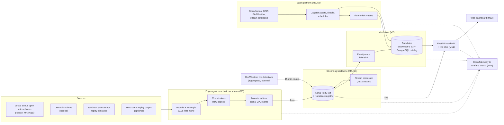

# Target architecture

This is the architecture the [roadmap](../ROADMAP.md) builds towards. Nothing
here exists yet; each part names the milestone that delivers it. Decisions
behind the choices are recorded in [ADRs](adr/).

## 1. System context

**The privacy boundary is the edge agent.** Audio exists only inside it, in
memory, for the length of one window. Everything to the right of the edge is
derived, minute-level (or one-second band-level) numbers
([ADR 0003](adr/0003-raw-audio-never-leaves-memory.md)).

## 2. Components

| Component | Responsibility | Tech | Milestone |
| :-- | :-- | :-- | :-- |
| `aviscape-dsp` | pure functions: spectrograms, acoustic indices, signal QA, event detection | NumPy, SciPy | M2 |
| `aviscape-synth` | seeded synthetic soundscapes and a replay simulator with fault and chaos injection | NumPy, `astral` | M3 |
| `aviscape-contracts` | Avro schemas, ODCS contracts, generated typed models | Avro, ODCS v3.1, `datacontract-cli` | M4 |
| `aviscape-edge` | stream adapters, windowing, duty cycling, producer, store-and-forward spool | PyAV, `sounddevice`, `confluent-kafka` | M5 |
| `aviscape-stream` | validation, dedup, event-time handling, enrichment, rollups, status, dawn-chorus onset | Quix Streams | M6 |
| lake sink | Kafka to DuckLake with offsets committed in the same catalog transaction | DuckDB + DuckLake | M7 |
| BirdWeather live context | `newDetection` subscription for nearby stations, aggregated in memory to 15-minute species counts | GraphQL client, Quix Streams | M6.11 |
| orchestration | external sources, maintenance, budgets, asset checks | Dagster 1.13 | M8 |
| transformations | staging, dimensions, facts, marts, baselines | dbt-core + dbt-duckdb | M9 |
| `aviscape-api` | read-only REST API, live server-sent events, false-colour tiles | FastAPI, Pydantic v2 | M11 |
| web | live view, map, daily soundscape, dawn chorus | TypeScript, Vite, MapLibre GL | M12 |
| platform | containers, compose profiles, Helm, GitOps, observability | Docker, kind, Helm 4, Argo CD, OpenTelemetry | M13–M16 |

## 3. Topics

Naming: `aviscape.<domain>.<entity>.v<major>`. Keys are `sensor_id` so that
all records of one microphone stay ordered in one partition. Retention is set
in time **and** bytes, derived from the storage budget
([ADR 0007](adr/0007-storage-and-bandwidth-budgets-as-code.md)).

| Topic | Payload | Cleanup | Retention | Into the lake |
| :-- | :-- | :-- | :-- | :-- |
| `aviscape.audio.minute-indices.v1` | summary indices and QA metrics per minute | delete | 3 days | yes |
| `aviscape.audio.spectral-indices.v1` | per-bin ACI, ENT, EVN, BGN, PMN per minute | delete | 1 day | yes |
| `aviscape.audio.events.v1` | detected acoustic events | delete | 3 days | yes |
| `aviscape.audio.band-levels.v1` | one-second third-octave band levels | delete | 24 hours | **no** (live view only) |
| `aviscape.sensor.heartbeat.v1` | liveness, decoder and buffer statistics | delete | 24 hours | aggregated |
| `aviscape.sensor.registry.v1` | sensor metadata (coarse location, codec, schedule) | compact | latest per key | yes, as SCD2 |
| `aviscape.sensor.status.v1` | online / degraded / offline / quarantined | compact | latest per key | yes |
| `aviscape.audio.minute-indices.enriched.v1` | validated, deduplicated, sun-relative, enriched | delete | 3 days | yes (silver) |
| `aviscape.context.birdweather-counts.v1` | 15-minute species detection counts per grid cell from nearby BirdWeather stations | delete | 7 days | yes |
| `aviscape.quality.dlq.v1` | rejected records with a reason code | delete | 7 days | yes (quarantine) |
| `aviscape.alerts.v1` | sensor offline, clipping, rain, budget alerts | delete | 7 days | yes |

## 4. Lake layout

DuckLake tables in three schemas. Data files are Parquet (zstd) in the
`aviscape-lake` bucket; metadata lives in PostgreSQL.

| Schema | Tables | Written by | Notes |
| :-- | :-- | :-- | :-- |
| `bronze` | `minute_indices`, `spectral_indices`, `events`, `heartbeats`, `dlq`, `stream_catalogue`, `weather_hourly`, `gbif_context`, `birdweather_counts` | lake sink, Dagster | append-only, with Kafka topic, partition, offset and ingest time |
| `silver` | `minute_indices` (deduplicated, flagged, sun-relative), `spectral_indices_q8` (uint8, 128 bins), `events`, `dq_results` | lake sink, dbt | one row per `(sensor_id, window_start)` |
| `gold` | `dim_sensor` (SCD2), `dim_date`, `dim_sun_time`, `fct_minute_indices`, `fct_acoustic_events`, `fct_weather_hourly`, `fct_birdweather_hourly`, `mart_daily_soundscape`, `mart_dawn_chorus`, `mart_weather_adjusted_activity`, `mart_species_context`, `mart_ldfc_index` | dbt | what the API reads |

## 5. Time semantics

- **Window**: 60 seconds, aligned to UTC minute boundaries; `window_start` is
  the key together with `sensor_id`.
- **Event time** is estimated from sample position and arrival time, because
  live streams carry no capture timestamp. Each record has
  `time_uncertainty_s`.
- **Sun-relative time**: every minute also gets `minutes_from_civil_dawn`
  and `sun_phase` (night, astronomical, nautical and civil twilight, day),
  which make days, seasons and sites comparable.
- **Late data**: accepted within a grace period (default 10 minutes) and
  routed to the DLQ with reason `LATE` afterwards; the count is a metric.

## 6. Processing guarantees

| Hop | Guarantee | How |
| :-- | :-- | :-- |
| Edge to Kafka | at least once, no loss on broker outage | idempotent producer, `acks=all`, bounded on-disk spool of features |
| Stream processor | exactly once (Kafka to Kafka) | Kafka transactions via Quix Streams |
| Kafka to lake | exactly once | consumer offsets stored in the catalog in the same transaction as the data |
| Lake to marts | idempotent | dbt models rebuilt per partition |
| Duplicates | none in silver | state-store dedup on `(sensor_id, window_start)` plus a unique test in dbt |

## 7. Deployment views

| View | What runs | Milestone |
| :-- | :-- | :-- |
| Laptop (Compose) | profiles `core` (Kafka, registry, edge, stream), `lake` (SeaweedFS, PostgreSQL, sink), `orchestration` (Dagster), `observability` (LGTM), `demo` (synthetic replay, API, web) | M1, M13 |
| Local Kubernetes (kind) | Helm chart for the services; Strimzi (Kafka), CloudNativePG, SeaweedFS and Dagster charts; Argo CD; Envoy Gateway; KEDA | M15 |
| Raspberry Pi | edge agent container only, sending features to the laptop or cluster | M17 |
| GitHub Pages | docs site and a static dashboard demo built from synthetic data | M0, M12 |
